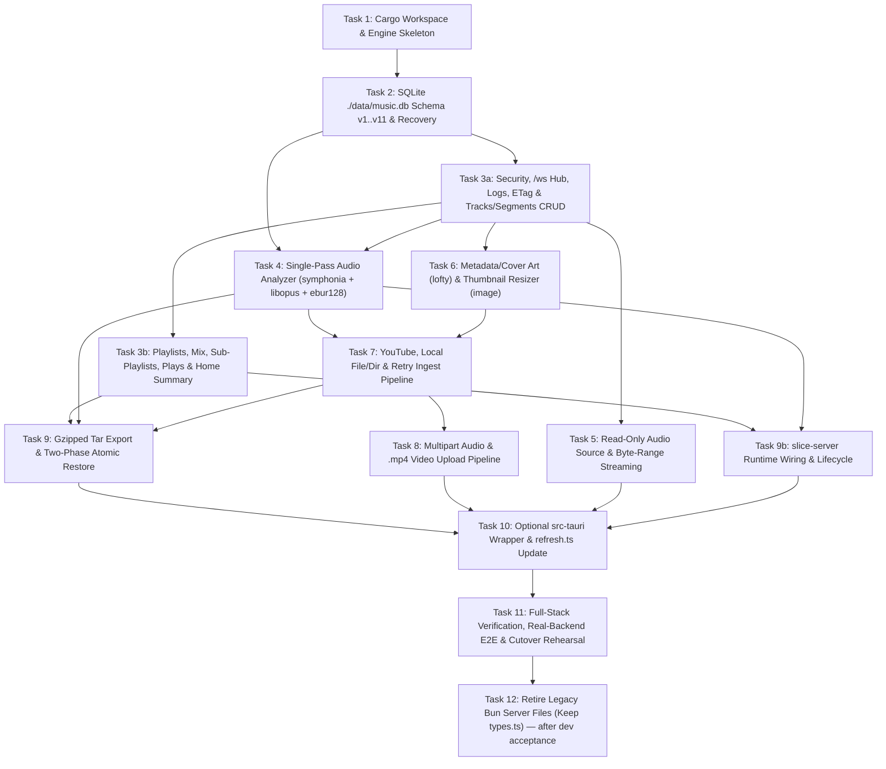

# Implementation Plan: Direction 1 — Pure-Rust Engine (`crates/engine`) + Desktop Shell Migration

## Goal
Replace the TypeScript/Bun backend runtime (`src/server/*.ts`, keeping only `src/server/types.ts` for frontend type-checking) with a headless, zero-GC Pure-Rust Engine (`crates/engine` / `slice-server`) and optional Tauri v2 desktop wrapper (`src-tauri`), achieving 100% API, WebSocket, SQLite (`./data/music.db`), security, and behavioral parity with zero changes to `src/client/src/`.

---

## Context

### Current System State
- **Frontend (`src/client/src/`)**: React 19 + TypeScript + TailwindCSS v4 + Shadcn + WaveSurfer.js v7 + Zustand.
  - Imports shared TypeScript interfaces (`Track`, `Segment`, `Playlist`, `PlaylistItem`, `PlaylistItemWithDetails`, `PlayRecord`, `HomeSummary`, `LogEntry`) from [`src/server/types.ts`](file:///home/gohans-linux/projects/slice-player/src/server/types.ts).
  - [`src/client/src/lib/audio.ts`](file:///home/gohans-linux/projects/slice-player/src/client/src/lib/audio.ts) uses dual-deck `HTMLAudioElement` (`el.crossOrigin = "anonymous"`) + Web Audio API (`AudioContext`, `MediaElementAudioSourceNode`, `GainNode` equal-power crossfades, and Sound Check loudness normalization via [`src/client/src/lib/soundCheck.ts`](file:///home/gohans-linux/projects/slice-player/src/client/src/lib/soundCheck.ts)).
  - Communicates with the backend via `fetch("/api/...")` and a single WebSocket at `/ws` (`{"type":"connected"}` on open, `"ping"` -> `"pong"` heartbeat).
- **Backend (`src/server/`)**: Bun HTTP + WebSocket server bound to `127.0.0.1:3000`:
  - [`src/server/db.ts`](file:///home/gohans-linux/projects/slice-player/src/server/db.ts): SQLite database at **`./data/music.db`** with 6 tables (`tracks`, `segments`, `playlists`, `playlist_items`, `playlist_sources`, `plays`), 15 indexes, `PRAGMA user_version = 1..11` migrations, 1-level sub-playlists (`parent_id` with auto-bubbling on item add and cascade removal from children on parent item delete), live mix playlists (`is_mix = 1`, `playlist_sources`), and startup orphan cleanup + `healTrackFilePaths`.
  - [`src/server/waveform.ts`](file:///home/gohans-linux/projects/slice-player/src/server/waveform.ts) & [`src/server/loudness.ts`](file:///home/gohans-linux/projects/slice-player/src/server/loudness.ts): Spawns `ffmpeg` twice per track (once for 200Hz mono `s8` 1,000 waveform peaks, and a second time for `-af ebur128=peak=true:framelog=quiet` parsing `I:` LUFS and `Peak:` dBFS from stderr, plus background `measureMissingLoudness()` worker).
  - [`src/server/ingest.ts`](file:///home/gohans-linux/projects/slice-player/src/server/ingest.ts) & [`src/server/audioExtractor.ts`](file:///home/gohans-linux/projects/slice-player/src/server/audioExtractor.ts): Orchestrates YouTube single/playlist ingest (`yt-dlp` with 2-slot metadata semaphore, queue depth 20, 10-min queue wait timeout, 5-min process timeout, 5-min cookie cooldown, fallback client retry, sequential download worker), local file & directory ingest (`validateSafeLocalAudioPath`, `loc_${md5_12char}`), multipart file uploads (`300 MiB` per file, up to 20 files), `.mp4` audio extraction (`ffprobe` stream check + `ffmpeg -vn -c:a copy` 30s -> `-c:a aac -b:a 256k` 60s fallback), and startup `recoverIncompleteIngests()`.
  - [`src/server/thumbnails.ts`](file:///home/gohans-linux/projects/slice-player/src/server/thumbnails.ts): Serves `/api/thumbs/:id(.ext)?size=small|large` (`192px` / `640px`) with 2-slot FIFO semaphore, in-flight deduplication, `.partial.jpg` atomic write+rename, cover-art version invalidation (`size:mtimeMs:ctimeMs`), and graceful fallback to original image.
  - [`src/server/backup.ts`](file:///home/gohans-linux/projects/slice-player/src/server/backup.ts), [`src/server/archiveWriter.ts`](file:///home/gohans-linux/projects/slice-player/src/server/archiveWriter.ts), [`src/server/backupLimits.ts`](file:///home/gohans-linux/projects/slice-player/src/server/backupLimits.ts), & [`src/server/libraryRequests.ts`](file:///home/gohans-linux/projects/slice-player/src/server/libraryRequests.ts): Streams `.tar.gz` export (`GET /api/library/export`, excluding `cookies.txt` by default) and performs two-phase atomic restore (`POST /api/library/import`) after pausing/draining all active HTTP mutations (`drainLibraryMutations`), ingests (`abortIngestProcesses`), and loudness measurements (`pauseMeasuringLoudness`).
  - [`src/server/appWindow.ts`](file:///home/gohans-linux/projects/slice-player/src/server/appWindow.ts): Single-instance check (`GET /api/tracks`), Chromium `--app` window launcher on Windows, 180s initial connection watchdog, and 60s WebSocket idle shutdown in production.

### Key Architectural Decisions
1. **Engine-First Cargo Workspace (`crates/engine` as `default-members`)**:
   - `crates/engine` (`slice-engine` lib + `slice-server` bin) is 100% decoupled from GUI system libraries (`webkit2gtk-4.1`), so `PATH="$HOME/.cargo/bin:$PATH" cargo test` compiles and passes headless on any Linux/Windows/macOS machine even when `pkg-config` / `libwebkit2gtk-4.1-dev` are not installed.
   - `slice-server` includes the `appWindow` single-instance check, `--app` browser window launcher, and WebSocket idle lifecycle out of the box, while `src-tauri` is provided as an excluded/optional desktop wrapper (`cargo check --manifest-path src-tauri/Cargo.toml` when GTK/WebView2 dev headers are installed).
2. **Embedded Loopback `axum` HTTP + WebSocket Server (`127.0.0.1:3000`)**:
   - Avoids Linux `WebKitGTK` GStreamer custom URI scheme (`sliceaudio://`) failures (`MEDIA_ERR_SRC_NOT_SUPPORTED`) and Web Audio API CORS errors.
   - Preserves 100% of `src/client/src/` without modifying a single frontend component or store.
3. **Single-Pass `O(1)` Streaming Audio Analysis (`symphonia` + `symphonia-adapter-libopus` + `ebur128`)**:
   - Registers `symphonia_adapter_libopus::OpusDecoder` (`features = ["bundled"]`) in a custom `CodecRegistry` so YouTube `format 251` (`.opus`/`.webm`) decodes natively in-process alongside MP3, AAC/M4A, FLAC, WAV, and Vorbis.
   - Streams decoded frames in a single pass through `ebur128::EbuR128` (`Mode::I | Mode::TRUE_PEAK`), converting linear true peak to dBTP (`20.0 * max_linear.log10()`, storing `NULL` on non-finite silence), while accumulating `1,000` waveform peaks (`[0.0, 1.0]`, 3 decimals, capped at `1800s`).
   - **Loudness policy = legacy parity.** Mono files are measured exactly like the legacy `ffmpeg -af ebur128=peak=true` default (single channel, **no** `Channel::DualMono`), because every loudness value already stored in `./data/music.db` was measured that way and the `ffmpeg` fallback uses the same filter. Switching mono files to dual-mono (+3 LU) is a separate, deliberate follow-up that must re-measure the whole library at once; it is out of scope for the port.
   - Falls back to `ffmpeg` CLI on unsupported codecs and `[0.1; 1000]` synthetic peaks on total failure.
4. **Test-Driven Porting of All 19 Existing `src/server/*.test.ts` Suites**:
   - Every task (Tasks 1–9) ports the behavioral assertions from its corresponding `src/server/*.test.ts` files (`appWindow.test.ts`, `audioExtractor.test.ts`, `audioSource.test.ts`, `backup.test.ts`, `backupLimits.test.ts`, `db.test.ts`, `etag.test.ts`, `ingest.test.ts`, `logger.test.ts`, `loudness.test.ts`, `mixPlaylist.test.ts`, `performance.test.ts`, `plays.test.ts`, `portablePaths.test.ts`, `restoreIngest.test.ts`, `security.test.ts`, `subPlaylist.test.ts`, `thumbnails.test.ts`, `websocketEvents.test.ts`) into Rust tests (`RED -> GREEN -> REFACTOR`) before moving to the next task.
   - `src/server/types.ts` is explicitly retained so `bun run typecheck` (`tsc --noEmit`), `bun run lint`, `bun test --isolate src/client src/launcher`, and `bun run test:e2e` pass with zero errors.

---

## Tasks

### Task 1: Initialize Cargo Workspace & `crates/engine` Skeleton
- **ID**: `task-1`
- **Size**: `S`
- **Depends on**: None
- **Files touched**:
  - `Cargo.toml`
  - `crates/engine/Cargo.toml`
  - `crates/engine/src/lib.rs`
  - `crates/engine/src/bin/slice-server.rs`
  - `.gitignore`
- **Description**:
  Create the Cargo workspace with `members = ["crates/engine"]` and `default-members = ["crates/engine"]`. Configure `crates/engine` (`slice-engine` lib + `slice-server` bin) with dependencies: `tokio`, `axum` (`ws`, `multipart`), `serde`, `serde_json`, `rusqlite` (`bundled`), `uuid` (`v4`), `thiserror`, `symphonia` (`all-codecs`, `all-formats`, `opt-simd`), `symphonia-adapter-libopus` (`bundled`), `ebur128`, `lofty`, `image` (`jpeg`, `png`, `webp`), `tar`, `flate2`, `sha2`, `md-5`, `tempfile`. Port unit tests from `src/server/appWindow.test.ts`.
- **Acceptance Criteria**:
  1. `PATH="$HOME/.cargo/bin:$PATH" cargo test` compiles and passes with zero warnings.
  2. `crates/engine` exports `EngineConfig` (`db_path`, `data_dir`, `dist_dir`, `port`, `is_production`, `is_test`) and `appWindow` helpers (`find_app_browser`, `is_server_running` polling `GET /api/tracks`, `open_app_window`). `slice-server` only `chdir`s to `<exe_dir>` when `./dist` is absent in the current working directory and `<exe_dir>/dist` exists, so running `target/release/slice-server` from the repo root uses the repo's `./data/music.db` and `./dist`.
  3. `WsLifecycleTracker::wait_for_shutdown(is_busy)` resolves exactly when the legacy `index.ts` would call `gracefulShutdown()`: no client within **180s** of startup, or **60s** after the last client disconnects (timer restarts if a client reconnects; re-arms another 60s while `is_busy()` reports an active ingest). Proven by `app_window_test.rs` with paused Tokio time. Wiring it into the running binary (production only) is Task 9b.
  4. `.gitignore` ignores `/target`.
- **Verification**:
  - `PATH="$HOME/.cargo/bin:$PATH" cargo test -p slice-engine --test app_window_test`

---

### Task 2: Port SQLite `./data/music.db` Schema (`v1..v11`), Pragmas, Startup Cleanup & Recovery
- **ID**: `task-2`
- **Size**: `M`
- **Depends on**: `task-1`
- **Files touched**:
  - `crates/engine/src/db/mod.rs`
  - `crates/engine/src/db/migrations.rs`
  - `crates/engine/src/db/maintenance.rs`
  - `crates/engine/src/models.rs`
  - `crates/engine/tests/db_test.rs`
- **Description**:
  Port database initialization, migrations, and maintenance from [`src/server/db.ts`](file:///home/gohans-linux/projects/slice-player/src/server/db.ts), [`src/server/ingest.ts:262-292`](file:///home/gohans-linux/projects/slice-player/src/server/ingest.ts#L262-L292), and [`src/server/types.ts`](file:///home/gohans-linux/projects/slice-player/src/server/types.ts), porting tests from `src/server/db.test.ts` and `src/server/portablePaths.test.ts`.
- **Acceptance Criteria**:
  1. Opens `./data/music.db` by default; **refuses** to open `./data/music.db` when `is_test == true` or `NODE_ENV == "test"` ([`src/server/db.ts:227-229`](file:///home/gohans-linux/projects/slice-player/src/server/db.ts#L227-L229)).
  2. Sets `PRAGMA busy_timeout = 5000`, `PRAGMA journal_mode = WAL`, `PRAGMA foreign_keys = ON`, `SQLITE_FCNTL_PERSIST_WAL = 0`, and runs `PRAGMA wal_checkpoint(TRUNCATE)` on `close_database()`.
  3. Executes base table creation (`tracks`, `segments`) and all 11 versioned migrations (`PRAGMA user_version = 1..11`) idempotently, creating `playlists`, `playlist_items`, `playlist_sources`, `plays` and all 15 indexes (`idx_tracks_created_at`, `idx_tracks_status`, `idx_segments_track`, `idx_segments_created_at`, `idx_playlist_items_playlist`, `idx_playlist_items_added`, `idx_playlist_items_track`, `idx_playlist_items_segment`, `idx_playlist_items_unique`, `idx_playlist_sources_source`, `idx_playlists_parent_id`, `idx_plays_played_at`, `idx_plays_track`, `idx_plays_segment`, `idx_plays_playlist`).
  4. Implements `get_cross_platform_basename` (handling both `\` and `/`), `heal_track_file_paths`, and startup orphan cache cleanup (deleting `.part`/`.ytdl`, unreferenced audio files checking both full path and basename, unreferenced thumbs, and `sweep_thumbnail_variants`).
  5. Implements `recover_incomplete_ingests()` matching [`src/server/ingest.ts:262-292`](file:///home/gohans-linux/projects/slice-player/src/server/ingest.ts#L262-L292): queries `tracks WHERE status IN ('queued', 'downloading')`, purges partial cache files (`purge_track_cache_files`), **updates** (never deletes!) their rows to `status = 'error'`, `error_message = "Tải bài hát bị gián đoạn do máy chủ khởi động lại. Vui lòng bấm Thử lại (Retry)."`, and emits `track_updated`.
  6. **Legacy upgrade is proven on a real legacy schema**, not on the latest schema with `user_version` rewound: the fixture builds the original `user_version = 0` tables (`tracks` without `volume`/`loudness`/`true_peak`, `segments`, no playlist tables) with representative rows, then asserts that opening it adds the missing columns with their defaults, keeps every row, rewrites `sqp=` thumbnails, creates all tables/indexes at `user_version = 11`, and that the data survives a close + reopen (second open is a no-op).
- **Verification**:
  - `PATH="$HOME/.cargo/bin:$PATH" cargo test -p slice-engine --test db_test`

---

### Task 3a: Security Middleware, `/ws` Hub, Logs, Weak ETag & Tracks/Segments CRUD Routes
- **ID**: `task-3a`
- **Size**: `M`
- **Depends on**: `task-2`
- **Files touched**:
  - `crates/engine/src/http/mod.rs`
  - `crates/engine/src/http/security.rs`
  - `crates/engine/src/http/ws_and_logs.rs`
  - `crates/engine/src/http/routes_tracks_segments.rs`
  - `crates/engine/src/db/tracks_segments.rs`
- **Description**:
  Port the HTTP security middleware, mutation tracking (`libraryRequests.ts`), weak ETag helper (`etag.ts`), logger (`logger.ts`), WebSocket hub (`websocketEvents.ts`), static `./dist` handler, and all Tracks & Segments CRUD endpoints from [`src/server/index.ts:149-1022`](file:///home/gohans-linux/projects/slice-player/src/server/index.ts#L149-L1022). Port tests from `etag.test.ts`, `logger.test.ts`, `websocketEvents.test.ts`, and `security.test.ts`.
- **Acceptance Criteria**:
  1. **Security & Mutation Gate (`security.rs`)**:
     - Tracks in-flight mutating requests (`POST`, `PUT`, `PATCH`, `DELETE` except `POST /api/library/import`) via `run_library_request` / `pause_library_mutations` / `drain_library_mutations`, returning `503` + `Retry-After: 5` when paused or `is_library_restoring()`.
     - Blocks `Sec-Fetch-Site: cross-site` on `/api/*` or non-top-level-GET navigation (`403`), validates `Host` (`127.0.0.1`, `localhost`, `[::1]`, `::1` on server port or `:5173` in dev -> `403`), and validates `Origin` (`http://127.0.0.1:<port>`, `http://localhost:<port>`, `http://[::1]:<port>`, `:5173` in dev, `tauri://localhost`, `http://tauri.localhost`, `https://tauri.localhost` -> `403`).
     - Enforces `Transfer-Encoding: chunked` rejection (`400`), required `Content-Length` (`411`, except optional body on `/retry` and `/api/tracks/retry-all`), and payload size caps (`413`: `2 GiB` on `/api/library/import`, `305 MiB` on `/api/tracks/upload`, `2 MiB` on batch/reorder routes, `64 KiB` on standard JSON routes).
  2. **WebSocket `/ws` & Logger (`ws_and_logs.rs`)**:
     - Upgrades `/ws` after Host/Origin check, sends `{"type":"connected"}`, replies `"pong"` to `"ping"`, and broadcasts all 14 `websocketEvents.ts` event types (`track_updated`, `track_created`, `track_deleted`, `tracks_deleted`, `segment_deleted`, `segment_updated`, `segments_deleted`, `playlist_created`, `playlist_updated`, `playlist_deleted`, `playlist_items_changed`, `app_log`, `logs_cleared`, `library_restored`).
     - Implements `GET /api/logs?limit=100` and `DELETE /api/logs` (`MAX_SERVER_LOGS = 200`), redacting CWD and `/home/<user>/` or `C:\Users\<user>\` paths via `sanitize_internal_paths`.
  3. **Tracks & Segments CRUD (`routes_tracks_segments.rs`)**:
     - `GET /api/tracks` (omits `peaks_json`, includes `segment_count` and `download_index`, returns weak ETag `W/"..."` + `304 Not Modified`).
     - `GET /api/tracks/:id` (includes full `peaks_json`).
     - `PUT /api/tracks/:id` & `PATCH /api/tracks/:id` (whitelists `title`, `artist`, `volume` in `[0.0, 1.0]`, emits `track_updated` with `reason: "volume" | "general"`). Internal `update_track` resets `loudness = NULL, true_peak = NULL` when `file_path` is updated unless `loudness` / `true_peak` are explicitly provided in the same update payload (and `create_track` accepts optional `loudness` / `true_peak`), so single-pass ingest persists peaks + loudness together without triggering a redundant second background decode.
     - `DELETE /api/tracks/:id` & `POST /api/tracks/batch-delete` (`{ ids }`, max `5000`; cancels active download/waveform, unlinks cached audio strictly under `./data/cache/audio/`, unlinks cached thumbs & variants, emits `track_deleted`/`tracks_deleted`, `segment_deleted`/`segments_deleted`, `playlist_items_changed`).
     - `GET /api/tracks/:id/segments`, `POST /api/tracks/:id/segments`, `PUT /api/segments/:id`, `DELETE /api/segments/:id`, `POST /api/segments/batch-delete` (`{ ids }`, max `5000`, returns `{ success: true, deletedCount }`), and `GET /api/segments` (weak ETag `304`).
     - Enforces exact segment validation: track must be `ready` with `duration > 0`; clamps `end_time` in `(duration, duration + 0.5]` to `duration`; requires `start_time >= 0`, `end_time - start_time >= 0.5`, `end_time <= 1800`, `end_time <= duration + 0.1`, `start_time < duration`.
- **Verification**:
  - `PATH="$HOME/.cargo/bin:$PATH" cargo test -p slice-engine --test http_and_crud_test` (a filter such as `http::` matches **0** tests because the suite lives in an integration-test target; always confirm the count with `-- --list`).

---

### Task 3b: Playlists, Mix Playlists, 1-Level Sub-Playlists, Plays & Home Summary Routes
- **ID**: `task-3b`
- **Size**: `M`
- **Depends on**: `task-3a`
- **Files touched**:
  - `crates/engine/src/db/playlists.rs`
  - `crates/engine/src/db/plays.rs`
  - `crates/engine/src/http/routes_playlists.rs`
  - `crates/engine/src/http/routes_plays.rs`
  - `crates/engine/tests/playlists_and_plays_test.rs`
- **Description**:
  Port all playlist, mix-playlist, sub-playlist, play-history, and Home summary logic and routes from [`src/server/db.ts:644-1440`](file:///home/gohans-linux/projects/slice-player/src/server/db.ts#L644-L1440), [`src/server/plays.ts`](file:///home/gohans-linux/projects/slice-player/src/server/plays.ts), and [`src/server/index.ts:1023-1435`](file:///home/gohans-linux/projects/slice-player/src/server/index.ts#L1023-L1435). Port tests from `mixPlaylist.test.ts`, `subPlaylist.test.ts`, and `plays.test.ts`.
- **Acceptance Criteria**:
  1. **Playlists & 1-Level Sub-Playlists**:
     - `GET /api/playlists` computes `item_count`, `cover_url` (only while `cover_track_id` is in playlist), and up to 4 `mosaic_urls` deduplicated by `track_id` in item order.
     - `POST /api/playlists` (`{ name, parent_id? }`) enforces 1-level nesting (`parent_id` must exist, cannot be a mix playlist, cannot already have a `parent_id`) and returns `201`.
     - `GET /api/playlists/:id` returns `{ ...playlist, items }` (omitting `peaks_json` on tracks).
     - `PATCH /api/playlists/:id` rejects `"parent_id" in body` (`400`), updates `cover_track_id` via `set_playlist_cover` (without bumping `updated_at`) or updates `name`, and emits `playlist_updated`.
     - `DELETE /api/playlists/:id` supports `?keep_children=true` or body `{ keep_children: true }` (promoting child sub-playlists to `parent_id = NULL` and emitting `playlist_updated` per child) vs `false` (deleting child sub-playlists and emitting `playlist_deleted` per child).
  2. **Mix Playlists**:
     - `POST /api/playlists/mix` (`{ name, source_ids }`) and `PUT /api/playlists/:id/sources` (`{ source_ids }`) require `>= 2` unique existing non-mix source playlists (rejecting self or mix sources), and compute live merged `items`, `item_count`, `cover_url`, and `mosaic_urls` deduplicated by `(track_id, segment_id)` in source order.
  3. **Playlist Items, Auto-Bubbling & Cascade Removal**:
     - `GET /api/playlist-memberships?track_id=...&segment_id=...&all=true`.
     - `POST /api/playlists/:id/items` (`201`) and `POST /api/playlists/:id/items/batch` (`200 { success: true, count, items }`) reject mix playlists, **auto-bubble** added `(track_id, segment_id)` pairs into `pl.parent_id` when adding to a sub-playlist, and emit `playlist_items_changed` for both `:id` and `pl.parent_id`.
     - `DELETE /api/playlists/:id/items/:itemId` and `POST /api/playlists/:id/items/batch-delete` (`{ itemIds }`) **cascade-delete** matching `(track_id, segment_id)` items from all child sub-playlists when removing from a parent playlist, emitting `playlist_items_changed` for `:id` and each child.
     - `PUT /api/playlists/:id/reorder` (`{ itemIds }`) validates exact duplicate-free permutation of playlist items, sets `is_custom_ordered = 1`, and emits `playlist_items_changed`.
  4. **Plays & Home Summary (`routes_plays.rs`)**:
     - `POST /api/plays` validates `PlayRecord` (`source_type` in `['playlist','mixed','slices_only','original_only','home']`, `playlist_id` required iff `source_type == 'playlist'`, `via_home` bool), records play (`404` if track missing), returns `204 No Content`.
     - `GET /api/home` returns `HomeSummary { recently_played (12), heavy_rotation (30d, ready tracks, 25), top_playlists (30d, 12) }`.
- **Verification**:
  - `PATH="$HOME/.cargo/bin:$PATH" cargo test -p slice-engine --test playlists_and_plays_test`

---

### Checkpoint 1 (End of Phase 1)
- Run `PATH="$HOME/.cargo/bin:$PATH" cargo test -p slice-engine` — all SQLite, security, WebSocket, Tracks, Segments, Playlists, Mix Playlists, Sub-Playlists, and Plays tests pass.

---

### Task 4: Single-Pass Streaming Audio Analyzer (`symphonia` + `libopus` + `ebur128`) & Loudness Worker
- **ID**: `task-4`
- **Size**: `M`
- **Depends on**: `task-2`, `task-3a`
- **Files touched**:
  - `crates/engine/src/audio_analysis/mod.rs`
  - `crates/engine/src/audio_analysis/decoder.rs`
  - `crates/engine/src/audio_analysis/loudness_worker.rs`
  - `crates/engine/tests/loudness_and_waveform_test.rs`
- **Description**:
  Replace `src/server/waveform.ts` and `src/server/loudness.ts` with a single-pass, `O(1)` memory streaming Rust analyzer and background `measure_missing_loudness` worker. Port tests from `loudness.test.ts`.
- **Acceptance Criteria**:
  1. Registers `symphonia_adapter_libopus::OpusDecoder` alongside `symphonia::default::register_enabled_codecs` so `.opus`/`.webm` (`format 251`), `.m4a`/AAC, `.mp3`, `.flac`, `.wav`, and `.ogg` decode in-process.
  2. Streams packets in a single pass inside `tokio::task::spawn_blocking`:
     - Feeds `ebur128::EbuR128::new(channels, sample_rate, Mode::I | Mode::TRUE_PEAK)`.
     - Keeps the meter's default channel map for mono (**no** `Channel::DualMono`), matching legacy `ffmpeg -af ebur128=peak=true` so new values are comparable with the loudness already stored in the library (see Key Architectural Decision 3).
     - Converts `meter.true_peak(ch)` linear ratio to dBTP via `20.0 * max_linear.log10()`, returning `None` (`NULL`) if loudness or true peak is non-finite (`-inf` on silence).
     - Collapses frames to mono, caps waveform accumulation at `1800s`, and outputs `1,000` `f32` peaks in `[0.0, 1.0]` (absolute amplitude, same scale as legacy `|s8| / 128`) rounded to 3 decimal places.
       - **Known, intentional divergence (dev signed off 2026-10-19: keep the native envelope, re-analyze the whole library after cutover):** legacy `ffmpeg -ac 1 -filter:a aresample=200` resamples with an anti-alias low-pass (~100 Hz), so legacy peaks only see bass (measured: a 0.5-amplitude 1 kHz tone → legacy max `0.03`, a 50 Hz tone → `0.53`). The native envelope takes the loudest raw mono sample per 1/200 s, i.e. what WaveSurfer itself would draw from `decodeAudioData` (the stated intent of `waveform.ts`). Existing tracks keep their stored `peaks_json`; newly analyzed tracks look taller/denser until the library is re-analyzed.
     - **Parity fixture**: for a mono and a stereo fixture, the native result matches the legacy `ffmpeg ... ebur128=peak=true:framelog=quiet` summary (`I:` within `0.1 LU`, `Peak:` within `0.2 dB`).
  3. Falls back to `ffmpeg` CLI if `symphonia` fails on an exotic/corrupt stream, and falls back to `[0.1; 1000]` synthetic peaks if `ffmpeg` also fails. Supports cancellation per file (`cancel_waveform_for_file`) and global abort (`abort_waveform_processes`).
  4. Implements `measure_missing_loudness()` scanning `status = 'ready' AND file_path IS NOT NULL AND loudness IS NULL ORDER BY created_at DESC`, skipping `unmeasurable` IDs until restart/restore, emitting `track_updated` (`reason: "loudness"`) every 10s + on completion, and supporting `pause_measuring_loudness()` (`pauseDepth` counter + clearing `unmeasurable` + killing active probe).
- **Verification**:
  - `PATH="$HOME/.cargo/bin:$PATH" cargo test -p slice-engine --test loudness_and_waveform_test`

---

### Task 5: Read-Only Fallback Audio Source & HTTP Byte-Range Streaming (`/api/tracks/:id/stream`)
- **ID**: `task-5`
- **Size**: `S`
- **Depends on**: `task-3a`
- **Files touched**:
  - `crates/engine/src/audio_source.rs`
  - `crates/engine/src/http/routes_stream.rs`
  - `crates/engine/src/http/mod.rs`
  - `crates/engine/tests/audio_source_and_stream_test.rs`
- **Description**:
  Port [`src/server/audioSource.ts`](file:///home/gohans-linux/projects/slice-player/src/server/audioSource.ts) and `/api/tracks/:id/stream` (`GET` and `HEAD`) from [`src/server/index.ts:691-789`](file:///home/gohans-linux/projects/slice-player/src/server/index.ts#L691-L789). Port tests from `audioSource.test.ts`.
- **Acceptance Criteria**:
  1. `resolve_audio_source(file_path, cache_dir)`:
     - Validates `validate_safe_local_audio_path(file_path)` (`403 Invalid or forbidden audio file path` if unsafe).
     - If missing at `file_path`, checks `join(cache_dir, get_cross_platform_basename(file_path))` and serves it **without writing to SQLite** (preserving the read-only fallback invariant tested in `audioSource.test.ts`). Returns `404` if missing in both places.
  2. Verifies file extension is in `SUPPORTED_AUDIO_EXTENSIONS` (`403` otherwise) and maps MIME types accurately (`.opus` and `.ogg` -> `audio/ogg`, `.m4a`/`.mp4` -> `audio/mp4`, `.mp3` -> `audio/mpeg`, `.flac` -> `audio/flac`, `.wav` -> `audio/wav`, `.webm` -> `audio/webm`, `.aac` -> `audio/aac`).
  3. Supports `HEAD` (`200`, `Content-Length`, `Accept-Ranges: bytes`) and `GET` with `Range: bytes=start-end`, `bytes=start-`, and suffix `bytes=-N` (`206 Partial Content` with `Content-Range: bytes start-end/size`, or `416 Range Not Satisfiable` with `Content-Range: bytes */size`).
- **Verification**:
  - `PATH="$HOME/.cargo/bin:$PATH" cargo test -p slice-engine --test audio_source_and_stream_test`

---

### Task 6: Audio Metadata/Cover Extraction (`lofty`) & Thumbnail Variants (`/api/thumbs/:id`)
- **ID**: `task-6`
- **Size**: `M`
- **Depends on**: `task-3a`
- **Files touched**:
  - `crates/engine/src/metadata.rs`
  - `crates/engine/src/thumbnails.rs`
  - `crates/engine/src/http/routes_thumbs.rs`
  - `crates/engine/tests/thumbnails_test.rs`
- **Description**:
  Port [`src/server/thumbnails.ts`](file:///home/gohans-linux/projects/slice-player/src/server/thumbnails.ts), `/api/thumbs/:id` from [`src/server/index.ts:792-826`](file:///home/gohans-linux/projects/slice-player/src/server/index.ts#L792-L826), and local metadata/cover extraction from [`src/server/ingest.ts:1203-1315`](file:///home/gohans-linux/projects/slice-player/src/server/ingest.ts#L1203-L1315). Port tests from `thumbnails.test.ts`.
- **Acceptance Criteria**:
  1. **Route Extension Stripping**: Matches `/^\/api\/thumbs\/([a-zA-Z0-9_-]+)(?:\.[a-zA-Z0-9]+)?$/` (stripping optional `.jpg`/`.png`/`.webp` extension from the URL parameter so `/api/thumbs/loc_123.jpg?v=ab12&size=small` resolves `thumbId = "loc_123"`).
  2. **On-Demand Resizing & Graceful Fallback**:
     - When `?size=small` (`192px`) or `?size=large` (`640px`) is requested, scales down (never up) into `./data/cache/thumbs-sized/${trackId}-${width}-${version}.jpg` using a 2-slot FIFO semaphore (`with_resize_slot`), in-flight deduplication map, atomic `.partial.jpg` write+rename, and post-resize `cover_art_version` (`size:mtimeMs:ctimeMs` hash) verification (unlinking the variant if source art changed mid-resize).
     - When `?size` is omitted, unrecognized, or scaling fails, **gracefully serves the original unresized thumbnail** (never returns `400`).
     - Returns `ETag: "${size_hex}-${mtime_hex}"`, `Cache-Control: public, max-age=86400`, and `304 Not Modified` on `If-None-Match`.
  3. **Local Metadata & Cover Art (`metadata.rs`)**: Extracts `title`, `artist`, `duration` (via `lofty` / `symphonia` with 5s `ffprobe` fallback), and embedded cover art (`4 bytes ..= 4 MiB`, magic-byte verified for JPEG `FF D8 FF`, PNG `89 50 4E 47`, WebP `RIFF....WEBP`), removing stale `.jpg`/`.png`/`.webp` files for that track before saving `./data/cache/thumbs/${trackId}${ext}` and returning `/api/thumbs/${trackId}${ext}?v=${md5_8char}`.
- **Verification**:
  - `PATH="$HOME/.cargo/bin:$PATH" cargo test -p slice-engine --test thumbnails_test`

---

### Checkpoint 2 (End of Phase 2)
- Run `PATH="$HOME/.cargo/bin:$PATH" cargo test -p slice-engine` — all Phase 1 + Phase 2 tests (`db`, `http`, `playlists_and_plays`, `loudness_and_waveform`, `audio_source_and_stream`, `thumbnails`) pass.

---

### Task 7: Port YouTube, Local File/Directory & Retry Ingest Pipeline
- **ID**: `task-7`
- **Size**: `M`
- **Depends on**: `task-4`, `task-6`
- **Files touched**:
  - `crates/engine/src/ingest/mod.rs`
  - `crates/engine/src/ingest/ytdlp.rs`
  - `crates/engine/src/ingest/local.rs`
  - `crates/engine/src/http/routes_ingest.rs`
  - `crates/engine/tests/ingest_test.rs`
- **Description**:
  Port `POST /api/tracks/ingest-youtube`, `POST /api/tracks/ingest-local`, `POST /api/tracks/retry-all`, and `POST /api/tracks/:id/retry` from [`src/server/ingest.ts`](file:///home/gohans-linux/projects/slice-player/src/server/ingest.ts) and [`src/server/index.ts:313-412, 633-688`](file:///home/gohans-linux/projects/slice-player/src/server/index.ts#L313-L412). Port tests from `ingest.test.ts`.
- **Acceptance Criteria**:
  1. **`POST /api/tracks/ingest-youtube`**:
     - Validates `YOUTUBE_URL_REGEX`, tracks active operation via `begin_ingest_operation` (returning `INGEST_PAUSED_MESSAGE` when paused for restore), acquires 2-slot metadata semaphore (max queue depth 20, 10-min queue wait timeout, 5-min process timeout).
     - Dynamically probes `PATH` for available JS runtimes (`bun`, `node`, `deno`, `quickjs`) for `--js-runtimes`, uses `./data/cookies.txt` if valid and not in 5-min auth cooldown (`COOKIE_COOLDOWN_MS`), and retries metadata/downloads with fallback client (`youtube:player_client=mweb,android,ios,web` vs `default,-tv`) and without cookies if needed.
     - Supports both single videos and playlists (`MAX_PLAYLIST_ITEMS = 5000`), selects best thumbnail via `resolve_best_youtube_thumbnail` (filtering out `sqp=`), queues `yt_${videoId}` rows (`status = 'queued'`), emits `track_created`/`track_updated`, and processes downloads sequentially (`concurrency = 1`, `--max-filesize 150M`, `duration <= 1800 + 2s`, single-pass waveform+loudness analysis persisted together on `update_track` / `create_track`, `reconcile_track_segments` emitting `segment_deleted`/`segment_updated`).
  2. **`POST /api/tracks/ingest-local`**:
     - Accepts `{ path?: string, paths?: string[] }` (max 50 paths, max 50 tracks per batch).
     - Validates every path with `validate_safe_local_audio_path` (blocking UNC `\\` / `//`, DOS devices `CON`/`PRN`/`AUX`/`NUL`/`COM1-9`/`LPT1-9`/`CONIN$`/`CONOUT$`, and NTFS ADS `:`) **before** touching the filesystem.
     - Supports both single audio/MP4 files (`ingest_local_file`, `loc_${md5(norm_path)[0..12]}`) and directories (`ingest_local_directory`, up to 100 audio files), reconciling segments on re-ingest and returning `200 { success: true, tracks, message }` or `400`.
  3. **`POST /api/tracks/retry-all` & `POST /api/tracks/:id/retry`**:
     - Resets cookie cooldown, requeues `status = 'error'` tracks (all or filtered by `track_ids`), and retries YouTube or local ingest.
  4. **Cancellation & Drain (`cancel_download_if_active`, `abort_ingest_processes`)**:
     - Kills child process trees (`kill(-pid, SIGKILL)` on Unix, `taskkill /F /T /PID` on Windows), cancels active waveform jobs, awaits in-flight `active_ingest_operations` promises so no zombie track/slice writes occur after cancellation, and purges `.part`/`.ytdl` files.
- **Verification**:
  - `PATH="$HOME/.cargo/bin:$PATH" cargo test -p slice-engine --test ingest_test`

---

### Task 8: Port Multipart Audio & `.mp4` Video Upload Pipeline (`POST /api/tracks/upload`)
- **ID**: `task-8`
- **Size**: `S`
- **Depends on**: `task-7`
- **Files touched**:
  - `crates/engine/src/ingest/upload.rs`
  - `crates/engine/src/ingest/video_extractor.rs`
  - `crates/engine/src/http/routes_ingest.rs`
  - `crates/engine/tests/audio_extractor_test.rs`
- **Description**:
  Port `POST /api/tracks/upload` (`ingestUploadedFile`) and `extractAudioFromVideo` from [`src/server/index.ts:414-457`](file:///home/gohans-linux/projects/slice-player/src/server/index.ts#L414-L457), [`src/server/ingest.ts:1451-1533`](file:///home/gohans-linux/projects/slice-player/src/server/ingest.ts#L1451-L1533), and [`src/server/audioExtractor.ts`](file:///home/gohans-linux/projects/slice-player/src/server/audioExtractor.ts). Port tests from `audioExtractor.test.ts`.
- **Acceptance Criteria**:
  1. Accepts `multipart/form-data` fields `"files"` and `"file"` (1 to 20 files per batch; `400` if 0 or `> 20` files; `300 MiB` max per file; `305 MiB` max request `Content-Length`).
  2. Streams uploaded file to temp file in `./data/cache/audio/temp_upload_*`, computes streaming MD5 content hash (`loc_${md5[0..12]}`), and renames to `loc_${hash}${ext}` (or extracts `.mp4` to `loc_${hash}.m4a`), cleaning up temp files on all exit paths.
  3. `extract_audio_from_video`: checks `has_audio_stream` via `ffprobe` (5s timeout), attempts fast stream copy `ffmpeg -v error -y -i input -vn -c:a copy output.m4a` (30s timeout), and falls back to `ffmpeg -v error -y -i input -vn -c:a aac -b:a 256k output.m4a` (60s timeout), unlinking partial output files on failure.
  4. Delegates to `ingest_local_file(final_path, preferred_title)` and returns `200 OK { success: true, tracks, message }` (or `400 { success: false, message }` if all files fail).
- **Verification**:
  - `PATH="$HOME/.cargo/bin:$PATH" cargo test -p slice-engine --test audio_extractor_test`

---

### Task 9: Port Gzipped Tar Export & Two-Phase Atomic Restore (`/api/library/export` & `/api/library/import`)
- **ID**: `task-9`
- **Size**: `M`
- **Depends on**: `task-3b`, `task-4`, `task-7`
- **Files touched**:
  - `crates/engine/src/backup/mod.rs`
  - `crates/engine/src/backup/limits.rs`
  - `crates/engine/src/backup/export.rs`
  - `crates/engine/src/backup/import.rs`
  - `crates/engine/tests/backup_and_restore_test.rs`
- **Description**:
  Port [`src/server/backup.ts`](file:///home/gohans-linux/projects/slice-player/src/server/backup.ts), [`src/server/archiveWriter.ts`](file:///home/gohans-linux/projects/slice-player/src/server/archiveWriter.ts), [`src/server/backupLimits.ts`](file:///home/gohans-linux/projects/slice-player/src/server/backupLimits.ts), and `/api/library/export` + `/api/library/import` from [`src/server/index.ts:1436-1488`](file:///home/gohans-linux/projects/slice-player/src/server/index.ts#L1436-L1488). Port tests from `backupLimits.test.ts`, `backup.test.ts`, and `restoreIngest.test.ts`.
- **Acceptance Criteria**:
  1. **Quotas & Filename Safety (`limits.rs`)**: Enforces `MAX_BACKUP_REQUEST_BYTES = 2 GiB`, `MAX_EXPORTED_BACKUP_BYTES = 2 GiB - 1 MiB`, `MAX_TOTAL_EXTRACTED_BYTES = 5 GiB`, `MAX_ARCHIVE_ENTRIES = 10_000`, `MAX_AUDIO_FILE_BYTES = 350 MiB`, `MAX_THUMB_FILE_BYTES = 15 MiB`, `MAX_DB_FILE_BYTES = 500 MiB`, `MAX_COOKIE_FILE_BYTES = 5 MiB`, `assert_export_fits_restore` (including PAX + deflateBound overhead), and `is_safe_archive_filename` (rejecting `/`, `\`, `..`, `:`, control chars, and Windows DOS names `CON`, `PRN`, `AUX`, `NUL`, `COM1..9`, `LPT1..9`).
  2. **Export (`GET /api/library/export`)**:
     - Returns `429` if export or restore is already running.
     - Runs `VACUUM INTO` temp `music.db`, normalizes `tracks.file_path` to `cache/audio/${name}` (hashing external local files with full 64-char hex SHA-256 `local_${sha256_hex(track.id)}${ext}` and `_${suffix}` collision disambiguation; aborts export with error if any `status === 'ready'` track is missing its audio file on disk).
     - **Excludes `cookies.txt` by default (`include_cookies = false`)** so exported backups never leak session credentials (`security.test.ts`).
     - Streams `.tar.gz` (`Content-Type: application/gzip`, `Content-Disposition: attachment; filename="slice-player-backup-${timestamp}.tar.gz"`).
  3. **Two-Phase Atomic Import (`POST /api/library/import`) & Deterministic Concurrency Test Hook**:
     - Accepts raw archive bytes or `multipart/form-data` (`file` or `backup` field).
     - Acquires `is_restoring = true`, `pause_ingest_operations()`, `pause_library_mutations()`, and `pause_measuring_loudness()`.
     - Validates all archive paths upfront, stages `music.db` (`<= 500 MiB`), verifies `PRAGMA quick_check` and that `sqlite_master` contains `tracks` and `segments` (allowing older schema versions to be upgraded by `init_database` migrations), rewrites `tracks.file_path` to `join(target_audio_cache_dir, name)` for packaged audio entries, and stages every file to `.slice-restore-*/*.incoming`.
     - Awaits `abort_ingest_processes()`, `drain_library_mutations()`, `abort_waveform_processes()`, and `close_database()`. Exposes an internal test synchronization barrier (`tokio::sync::Notify` / pause hook) so `backup_and_restore_test.rs` deterministically tests mid-analysis ingest/DELETE vs. restore races without `sleep` flakiness (`restoreIngest.test.ts` parity).
     - Moves live files (including `music.db-wal` and `music.db-shm`) to `.previous`, renames `.incoming` into place, runs `init_database(target_db_path)` and `heal_track_file_paths(target_audio_cache_dir)`, and rolls back all `.previous` files in reverse order on any error.
     - Broadcasts `library_restored` and `playlist_items_changed`, returning `200 { success: true, manifest, message }`.
- **Verification**:
  - `PATH="$HOME/.cargo/bin:$PATH" cargo test -p slice-engine --test backup_and_restore_test`

---

### Checkpoint 3 (End of Phase 3)
- Run `PATH="$HOME/.cargo/bin:$PATH" cargo test -p slice-engine` — all ported server test suites pass in Rust.

---

### Task 9b: `slice-server` Runtime Wiring (`start_server`, Startup Sequence, Lifecycle & Graceful Shutdown)
- **ID**: `task-9b`
- **Size**: `S`
- **Depends on**: `task-3b`, `task-4` (can start early; later tasks plug their routes/workers into the same `AppState`)
- **Files touched**:
  - `crates/engine/src/lib.rs`
  - `crates/engine/src/server.rs`
  - `crates/engine/src/bin/slice-server.rs`
  - `crates/engine/tests/server_runtime_test.rs`
- **Description**:
  Port the boot sequence of [`src/server/index.ts:28-86, 1561-1611`](file:///home/gohans-linux/projects/slice-player/src/server/index.ts#L28-L86) into `slice_engine::start_server(config)` and make `slice-server` call it. Until this task lands, `slice-server` is only a skeleton.
- **Acceptance Criteria**:
  1. Order matches legacy: `maybe_chdir_to_exe_dir` → production single-instance check (`is_server_running` → `open_app_window` → exit 0) → `Db::open` (+ migrations, orphan sweep, `heal_track_file_paths`) → `recover_incomplete_ingests` → start the loudness worker and re-trigger it on `track_created` / `track_updated` → bind `127.0.0.1:<port>` → `open_app_window` in production.
  2. Production lifecycle: `WsLifecycleTracker::wait_for_shutdown(is_ingest_busy)` (Task 1) triggers graceful shutdown; SIGINT/SIGTERM (and Ctrl-Break on Windows) do the same. Graceful shutdown stops accepting connections, aborts ingest + analysis, checkpoints WAL via `Db::close`, then exits 0.
  3. `server_runtime_test.rs` boots `start_server` on an ephemeral port in a temp working directory and proves: `/api/tracks` answers, `/ws` sends `{"type":"connected"}`, and a pre-seeded `downloading` track is reported as `error` after boot.
- **Verification**:
  - `PATH="$HOME/.cargo/bin:$PATH" cargo test -p slice-engine --test server_runtime_test`

---

### Task 10: Scaffold Optional `src-tauri` Desktop Wrapper & Update `src/launcher/refresh.ts`
- **ID**: `task-10`
- **Size**: `S`
- **Depends on**: `task-9`, `task-9b`
- **Files touched**:
  - `Cargo.toml`
  - `src-tauri/Cargo.toml`
  - `src-tauri/tauri.conf.json`
  - `src-tauri/src/main.rs`
  - `src/launcher/refresh.ts`
- **Description**:
  Create the optional `src-tauri` Tauri v2 shell (excluded from default Cargo workspace build via `exclude = ["src-tauri"]` in root `Cargo.toml` so headless machines without `webkit2gtk-4.1` dev packages never fail `cargo test`), and update `src/launcher/refresh.ts` to watch `crates/engine/src`, `Cargo.toml`, and `crates/engine/Cargo.toml` (excluding `crates/engine/tests` so test-only edits do not trigger restarts) and rebuild the `slice-server` binary when server sources change.
- **Acceptance Criteria**:
  1. `src-tauri/src/main.rs` boots `slice_engine::start_server` in-process and points the Tauri `WebviewWindow` (`Slice`, `1400x900`) to `http://127.0.0.1:3000`, shutting down child processes and checkpointing SQLite WAL on window exit.
  2. Root `Cargo.toml` keeps `members = ["crates/engine"]` and `exclude = ["src-tauri"]` so `PATH="$HOME/.cargo/bin:$PATH" cargo test` and `cargo build --release` succeed on this Linux host without `pkg-config` / `libwebkit2gtk-4.1-dev`.
  3. `src/launcher/refresh.ts` watches `crates/engine/src`, `Cargo.toml`, and `crates/engine/Cargo.toml`, rebuilds `slice-server` when Rust sources are newer than the binary, and `src/launcher/refresh.test.ts` continues to pass (`bun test --isolate src/launcher`).
  4. *(Optional, only if the Tauri shell ships)* Smoke-test playback inside the real WebView on each target OS: on Linux WebKitGTK decodes `<audio>` through GStreamer even over HTTP loopback, so `.opus`/`.webm`/`.m4a` playback depends on the installed GStreamer plugins (see Tauri's AppImage GStreamer notes).
- **Verification**:
  - `PATH="$HOME/.cargo/bin:$PATH" cargo test -p slice-engine && bun test --isolate src/launcher`

---

### Task 11: Full-Stack Integration Verification, Real-Backend E2E & Cutover Rehearsal
- **ID**: `task-11`
- **Size**: `M`
- **Depends on**: `task-10`
- **Files touched**:
  - `crates/engine/tests/security_and_concurrency_test.rs`
  - `playwright.rust.config.ts`
  - `e2e/rust-backend/*.spec.ts`
  - `package.json`
  - `start.bat`
- **Description**:
  Run full end-to-end verification of the Rust `slice-server` binary serving the built `./dist` React frontend, add a Playwright suite that talks to the **real** Rust backend, rehearse the cutover on a copy of the real library, then switch `package.json` / `start.bat` to `slice-server` while keeping the Bun runtime runnable (`start:bun`) until acceptance.
- **Acceptance Criteria**:
  1. `crates/engine/tests/security_and_concurrency_test.rs` verifies all cross-module security and concurrency invariants from `security.test.ts` and `performance.test.ts`.
  2. `bun run build` builds `./dist` and `PATH="$HOME/.cargo/bin:$PATH" cargo build --release -p slice-engine --bin slice-server` produces the standalone `target/release/slice-server` binary.
  3. All existing frontend & launcher tests pass (`bun test --isolate src/client src/launcher`, `bun run typecheck`, `bun run lint`, `bun run test:e2e`). Note: the existing `bun run test:e2e` suite starts only Vite and mocks every API/WebSocket call (`e2e/mock-library.ts`), so it proves the UI, **not** the Rust backend.
  4. **Real-backend E2E (`bun run test:e2e:rust`)**: `playwright.rust.config.ts` starts `target/release/slice-server` as `webServer` with its working directory set to a fresh temp dir (`dist` symlinked in, so `./data/music.db` and `./data/cache` are throwaway), with **no** request or WebSocket mocks. Specs cover: `/ws` connected + a live `track_updated` reaching the UI, local ingest of a fixture file → waveform rendered → `<audio>` stream answered with `206`, segment + playlist + mix/sub-playlist CRUD through the UI, and **export → import** of the library (`.tar.gz` round-trip, `library_restored` reload, same tracks/playlists afterwards).
  5. Live inspection with `agent-browser` (isolated session) against `target/release/slice-server` on `http://127.0.0.1:3000` confirms zero console errors, zero uncaught page errors, zero failed network requests.
  6. **Cutover rehearsal on a copy (no real library touched)**: with the Bun server stopped, copy `./data` to a scratch dir, take an SQLite-consistent snapshot (`sqlite3 data/music.db ".backup …"`, never a raw copy of a live WAL DB), boot `slice-server` against the copy, and diff `GET /api/tracks`, `/api/segments`, `/api/playlists`, `/api/home` against the Bun server booted on an identical second copy. Also diff the cache directory listing before/after the Rust boot, because startup runs the orphan-cache sweep (deletes unreferenced audio/thumbs). Any unexpected difference or deleted file blocks cutover.
  7. **Rollback path**: before the first Rust run on the real library, `./data` gets a consistent snapshot (step 6 recipe, kept outside `./data`), `package.json` keeps `start:bun` / `dev:bun` scripts that start the legacy server, and rolling back = stop `slice-server`, restore the snapshot, run `start:bun`. Documented in the PR description.
  8. *(Optional)* Baseline numbers recorded in the PR: analysis wall time + peak RSS for a 3-min and a 30-min track (Bun+ffmpeg vs Rust), and `/api/tracks` latency while the analyzer is busy.
- **Verification**:
  - `PATH="$HOME/.cargo/bin:$PATH" cargo test -p slice-engine && bun test --isolate src/client src/launcher && bun run typecheck && bun run lint && bun run test:e2e && bun run test:e2e:rust`

---

### Task 12: Retire Legacy Bun Server Runtime Files (Retaining `src/server/types.ts`)
- **ID**: `task-12`
- **Size**: `S`
- **Depends on**: `task-11` **and the dev's explicit acceptance after running the Rust server on the real library** (deleting the Bun runtime removes the rollback path in Task 11.7, so it is a one-way door).
- **Files touched**:
  - `package.json`
  - `src/server/` (delete runtime `.ts` and `.test.ts` files while **keeping `src/server/types.ts`**)
- **Description**:
  Remove deprecated TypeScript server implementation files in `src/server/` while preserving `src/server/types.ts` (imported by 55+ files in `src/client/src/` and `e2e/`), remove `start:bun` / `dev:bun`, and remove unused server-only npm dependencies (`music-metadata`, `tar-stream`, `@types/tar-stream`) from `package.json`.
- **Acceptance Criteria**:
  1. `src/server/types.ts` remains intact and `bun run typecheck` (`tsc --noEmit`) + `bun run lint` (`oxlint --type-aware`) + `bun run build` (`vite build`) pass with zero errors.
  2. `bun test --isolate` and `bun run test:e2e` pass 100%.
  3. `PATH="$HOME/.cargo/bin:$PATH" cargo test -p slice-engine` passes 100%.
- **Verification**:
  - `PATH="$HOME/.cargo/bin:$PATH" cargo test -p slice-engine && bun run typecheck && bun run lint && bun test --isolate && bun run build`

---

### Checkpoint 4 (Final Cutover & Verification)
- Run `PATH="$HOME/.cargo/bin:$PATH" cargo test -p slice-engine && bun run typecheck && bun run lint && bun test --isolate && bun run test:e2e && bun run test:e2e:rust` and verify live app in `agent-browser` before closing the browser session.

---

## Dependency Graph

- **Critical Path**: `Task 1 -> Task 2 -> Task 3a -> Task 4 -> Task 7 -> Task 9 -> Task 10 -> Task 11 -> Task 12`
- **Parallelizable Groups**:
  - After `Task 3a`: `Task 3b` (Playlists/Plays/Home), `Task 4` (Audio Analyzer), `Task 5` (Audio Stream), and `Task 6` (Metadata & Thumbnails) can be developed in parallel.
  - After `Task 4`: `Task 9b` (runtime wiring) can land early so every later task is smoke-testable against a running binary.
  - After `Task 7`: `Task 8` (Multipart Upload) and `Task 9` (Backup/Restore) can be developed in parallel.

---

## Risks and Mitigations

| Risk | Impact | Mitigation |
| :--- | :--- | :--- |
| YouTube `format 251` (`.opus`/`.webm`) fails to decode in default `symphonia` | High — YouTube ingests fail waveform/loudness extraction | Register `symphonia-adapter-libopus` (`features = ["bundled"]`) in custom `CodecRegistry` + retain `ffmpeg` CLI fallback. |
| Native loudness differs from the legacy `ffmpeg ebur128` values already stored in the library (mono channel weighting, true-peak oversampling, linear-vs-dBTP) | High — Sound Check gain in `soundCheck.ts` becomes inconsistent between old and new songs | Keep legacy mono policy (no `DualMono`), convert `true_peak` via `20.0 * linear.log10()`, store `NULL` on non-finite values, and gate Task 4 on a parity fixture against `ffmpeg`'s own summary. |
| First Rust boot on the real library deletes or rewrites data (orphan-cache sweep, path healing, migrations) | Critical — irreversible loss of audio cache / DB rows | Task 11.6 rehearsal on a copy with API + cache-listing diffs, Task 11.7 consistent snapshot + `start:bun` rollback, Task 12 only after explicit dev acceptance. |
| Existing Playwright suite mocks all API/WebSocket traffic | High — green E2E while the Rust backend is broken | Task 11.4 real-backend Playwright suite against `slice-server` with throwaway data dir. |
| Linux host lacks `pkg-config` and `libwebkit2gtk-4.1-dev` | Critical — `cargo test --workspace` would fail if `src-tauri` is a default member | Keep `crates/engine` 100% pure headless Rust with `members = ["crates/engine"]` and `exclude = ["src-tauri"]`, and port `appWindow.ts` into `slice-server`. |
| Deleting `src/server/types.ts` breaks 55+ frontend/E2E imports | Critical — `bun run typecheck` and `bun run build` fail | Explicitly retain `src/server/types.ts` in Task 12 while removing only runtime server `.ts` files. |
| Exporting `cookies.txt` by default leaks user YouTube session credentials | Critical — Security regression vs `security.test.ts` | Default `include_cookies = false` in `export_library_archive` and never include `cookies.txt` on `GET /api/library/export`. |
| In-flight HTTP delete/update races with `/api/library/import` database swap | High — Corrupts restored files or SQLite state | Implement `pause_library_mutations()` + `drain_library_mutations()` and `abort_ingest_processes()` before closing/swapping `music.db`. |
| `GET /api/tracks/:id/stream` fallback mutates SQLite during concurrent restore/delete | Medium — Stale read overwrites DB state (`audioSource.test.ts`) | `resolve_audio_source` resolves `./data/cache/audio/<basename>` strictly read-only without writing to SQLite. |

---

## Open Questions
None — all route contracts, database invariants, security rules, and host environment constraints have been verified directly against `src/server/*.ts` and `src/server/*.test.ts`.
